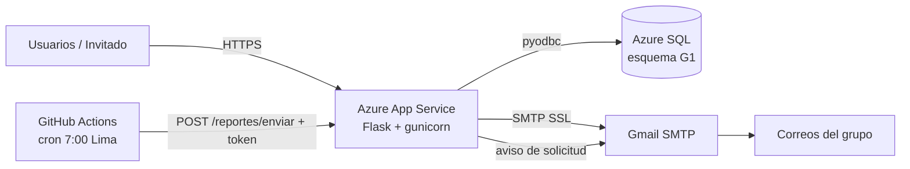

# Aplicación web de retención de clientes (Azure) — Grupo 1

Aplicación de negocio en la nube para el caso de **retención de clientes de telecomunicaciones** (curso *Building Cloud Business Applications*, PUCP — Diplomatura en Business Analytics). Trabaja sobre la base **Azure SQL** del grupo (esquema `G1`).

## Qué hace
- **Autenticación y roles:** administrador, supervisor, agente e invitado (solo lectura).
- **CRUD** de intervenciones, contratos, clientes, agentes y planes.
- **Dashboard** con indicadores y gráficos (Chart.js) sobre datos reales.
- **Usuarios:** el administrador crea cuentas; cada persona cambia su clave en el primer ingreso y luego desde *Mi cuenta*.
- **Acceso de invitado con aprobación:** quien solicita acceso ve solo el dashboard (4 h, sin modificar nada) cuando un administrador lo aprueba desde un enlace enviado por correo.
- **Reporte diario por correo** (7:00 a. m. hora de Lima) a los miembros del grupo, con cambios frente al reporte anterior, tendencia, actividad y contratos a vigilar, más un **HTML interactivo adjunto**.

## Arquitectura

## Estructura
| Ruta | Contenido |
|---|---|
| `app.py` | Aplicación Flask (rutas, permisos, reportes) |
| `templates/` | Plantillas HTML |
| `vendor/chart.umd.js` | Chart.js 4.4.1 (para el HTML interactivo sin internet) |
| `sql/01_tablas_app.sql` | Tablas propias de la app (documentación; la app las crea sola) |
| `../.github/workflows/reporte-diario.yml` | Envío diario automático |

## Configuración (variables de entorno en Azure App Service → *Variables de entorno*)
Las claves **no** están en este repositorio.

| Variable | Uso |
|---|---|
| `DB_SERVER`, `DB_NAME`, `DB_USER`, `DB_PASSWORD` | Conexión a Azure SQL |
| `SECRET_KEY` | Firma de sesiones |
| `SETUP_CODE` | Código para crear el primer administrador |
| `SMTP_USER`, `SMTP_PASSWORD` | Cuenta Gmail emisora (contraseña de aplicación) |
| `REPORT_TOKEN` | Token que autoriza el envío diario desde GitHub Actions |
| `APP_URL` (opcional) | URL pública para los enlaces de los correos |

Secretos del repositorio para el envío diario: `APP_URL` y `REPORT_TOKEN`.

## Despliegue (plan gratuito F1, Linux, Python 3.12)
1. Subir el contenido de esta carpeta a `/home/site/wwwroot` (Kudu → administrador de archivos).
2. Comando de inicio: instala dependencias y arranca `gunicorn` (ODBC Driver 18 para SQL Server).
3. Reiniciar la aplicación y abrir la URL.

## Seguridad
Contraseñas con hash, protección CSRF, permisos por rol, invitados de solo lectura con vencimiento, solicitudes que caducan y límite de solicitudes por hora.
